

All diagrams were generated with Python (matplotlib).

## Index

| S. No. | Experiment |
|:-:|---|
| 1 | [(a) Use Case Diagram (b) DFD Level 0 Diagram](#experiment-1-use-case-diagram-and-dfd-level-0-diagram) |
| 2 | [Work Breakdown Structure (WBS) – Inkswap](#experiment-2-work-breakdown-structure-wbs--inkswap) |
| 3 | [Gantt Chart](#experiment-3-gantt-chart) |
| 4 | [Work Breakdown Structure (WBS) – SCIMS](#experiment-4-work-breakdown-structure-wbs--scims) |
| 5 | [Decision Tree](#experiment-5-decision-tree) |
| 6 | [Risk Analysis](#experiment-6-risk-analysis) |
| 7 | [Network Diagram and Gantt Chart](#experiment-7-network-diagram-and-gantt-chart) |
| 8 | [Critical Path Method (CPM)](#experiment-8-critical-path-method-cpm) |
| 9 | [PERT (Program Evaluation and Review Technique)](#experiment-9-pert-program-evaluation-and-review-technique) |
| 10 | [Resource Levelling](#experiment-10-resource-levelling) |

---

## Experiment 1: Use Case Diagram and DFD Level 0 Diagram

### Aim
To draw (a) a Use Case Diagram and (b) a Level 0 Data Flow Diagram (context diagram) for a given software system.

### Theory
**Use Case Diagram.** A UML behavioural diagram that captures the functional requirements of a system from the user's point of view. Its elements are:

- **Actor** – a person or external system that interacts with the system (drawn as a stick figure).
- **Use case** – a goal the actor achieves with the system (drawn as an ellipse).
- **System boundary** – a rectangle that separates the system from its environment.
- **Relationships** – association (actor–use case), *«include»* (a use case always uses another), *«extend»* (optional behaviour added to a base use case) and generalisation.

**Data Flow Diagram (DFD).** A DFD shows how data moves through a system. At **Level 0** (context diagram) the whole system is shown as a *single process* surrounded by the *external entities* it exchanges data with; arrows are labelled with the *data flows*. No data stores or internal processes appear at this level – they are introduced in Level 1 and lower diagrams.

### Situation
**QuickBite** is a start-up building an online food ordering system. Customers register, browse menus, search restaurants, add items to a cart, place orders, pay online through a payment gateway, track their order and rate it. Restaurants manage their menus and accept/prepare orders. Delivery partners update the delivery status, and an administrator manages users and views reports. Draw the use case diagram and the Level 0 DFD for QuickBite.

### Solution
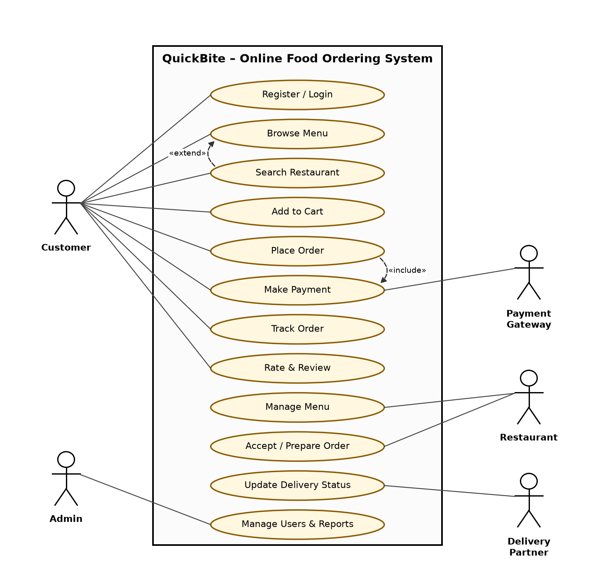
*Use Case Diagram – QuickBite*

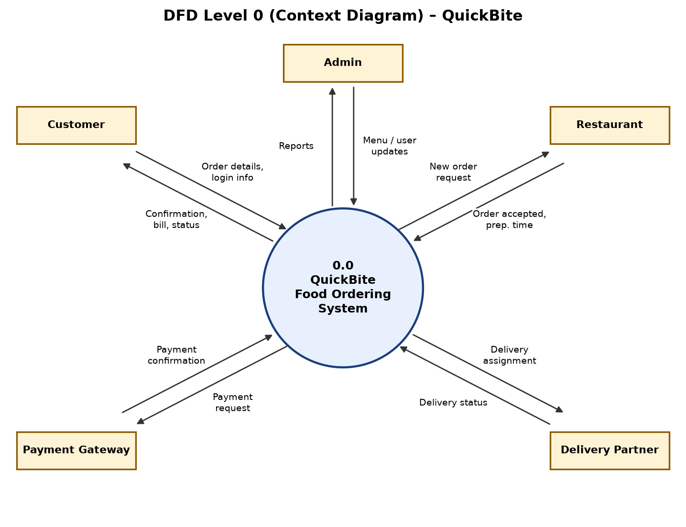
*DFD Level 0 – QuickBite*

### Conclusion
The use case diagram for QuickBite identified five actors and twelve use cases, including an *include* relation (Place Order → Make Payment) and an *extend* relation (Search Restaurant → Browse Menu). The Level 0 DFD represented the complete system as one process exchanging data with five external entities. Together they define the scope and the external interfaces of the system.

---

## Experiment 2: Work Breakdown Structure (WBS) – Inkswap

### Aim
To prepare a Work Breakdown Structure for the Inkswap project.

### Theory
A **Work Breakdown Structure** is a hierarchical, deliverable-oriented decomposition of the total scope of a project into smaller, manageable components called *work packages*. Key points:

- Level 1 is the project itself; Level 2 contains the major phases or deliverables; lower levels contain work packages.
- Each element has a unique *WBS code* (1.0, 1.1, 1.1.1, …).
- **100% rule** – the children of a node together represent all of the work of the parent, and nothing more.
- Work packages are small enough to be estimated, scheduled, assigned and tracked; they become the basis for cost estimation, scheduling and resource allocation.

A WBS may be *phase-oriented* (initiation, analysis, design, …) or *product-oriented* (modules of the system).

### Situation
**Inkswap** is a web and mobile platform on which college students exchange or sell second-hand books and stationery. The project covers initiation, requirement analysis, design, development of the user/auth, book-listing, swap/chat and payment modules, testing, and deployment on the cloud and Play Store, followed by project closure. Prepare a phase-oriented WBS for Inkswap.

### Solution
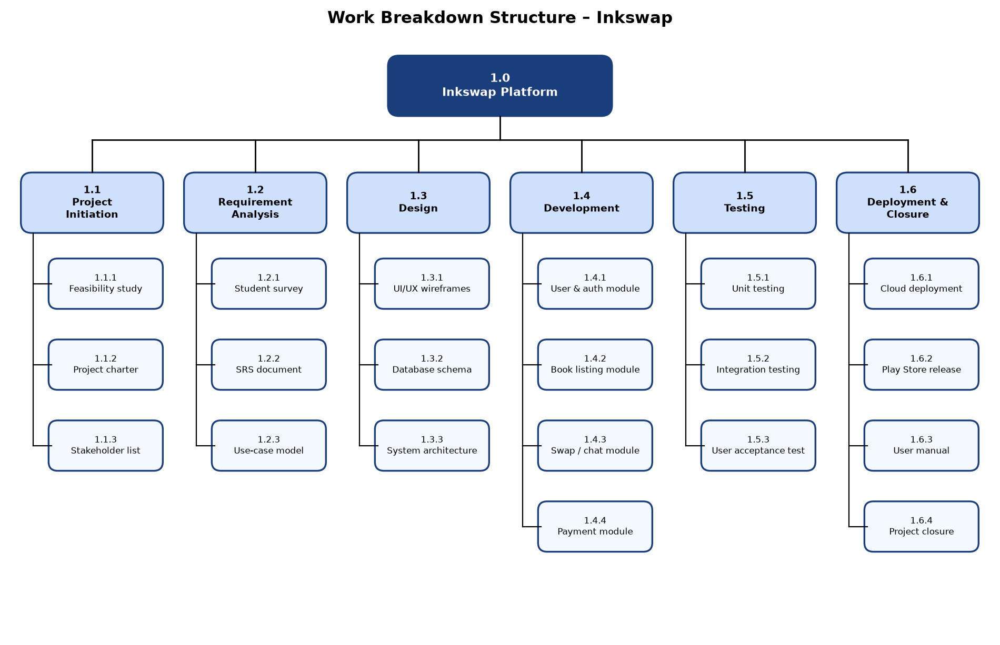
*WBS – Inkswap*

### Conclusion
The Inkswap project was decomposed into six Level-2 phases and twenty Level-3 work packages, each with a unique WBS code. The WBS satisfies the 100% rule and provides a clear basis for estimating effort, assigning team members and tracking progress.

---

## Experiment 3: Gantt Chart

### Aim
To prepare a Gantt chart for scheduling and tracking the activities of a software project.

### Theory
A **Gantt chart**, introduced by Henry Gantt, is a horizontal bar chart that shows project activities against a calendar time-line.

- Each activity is a bar whose start and length represent its start date and duration.
- Overlapping bars show activities that run in parallel.
- **Milestones** (zero-duration events such as sign-offs) are shown as diamonds.
- The shaded part of a bar shows *percentage complete*, and a vertical *status-date* line shows whether work is ahead of or behind schedule.

Gantt charts are easy to read and communicate the schedule well, but they do not show dependencies clearly; for that, network diagrams are used.

### Situation
A team of six is developing **PayNest**, a mobile banking application, starting 5 January 2026. The activities are requirement gathering, feasibility and budgeting, UI/UX design, database and API design, login and KYC module, fund transfer/UPI, bill payments, notifications, security testing, system and UAT testing, store deployment, and user training. The milestones are design sign-off, code freeze and go-live. Draw a Gantt chart showing the schedule and progress as of the status date (1 March 2026).

### Solution
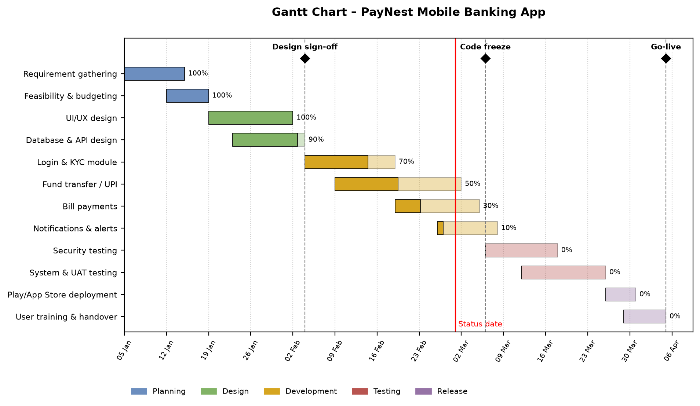
*Gantt Chart – PayNest*

### Conclusion
The Gantt chart shows the PayNest schedule over about thirteen weeks, with parallel activities, three milestones and the progress of each task. At the status date the planning and design phases are complete, while development is partly done, so the manager can see which tasks need attention to meet the go-live date.

---

## Experiment 4: Work Breakdown Structure (WBS) – SCIMS

### Aim
To prepare a Work Breakdown Structure for the SCIMS project.

### Theory
A WBS breaks the project scope down into deliverables and work packages arranged in levels. For a large information system a **product-oriented** WBS is often used: the Level-2 elements are the functional modules of the system, plus project management, testing and rollout. Guidelines for a good WBS:

- Use nouns (deliverables), not verbs, for the elements.
- Follow the 100% rule and keep elements mutually exclusive.
- Decompose until a work package can be done by one person or team in a short period (the *8/80 rule*: between 8 and 80 hours).
- Include project management as a separate branch.

A WBS dictionary normally accompanies the chart, describing each work package, its owner, cost and acceptance criteria.

### Situation
A college wants to replace its paper records with **SCIMS** – a *Smart College Information Management System*. SCIMS must handle student admission, attendance and fees; timetables, exams and results and a faculty portal; and the library, hostel and inventory. The project also includes requirement gathering, project management, testing (including a security audit), data migration, staff training and go-live support. Prepare a product-oriented WBS for SCIMS.

### Solution
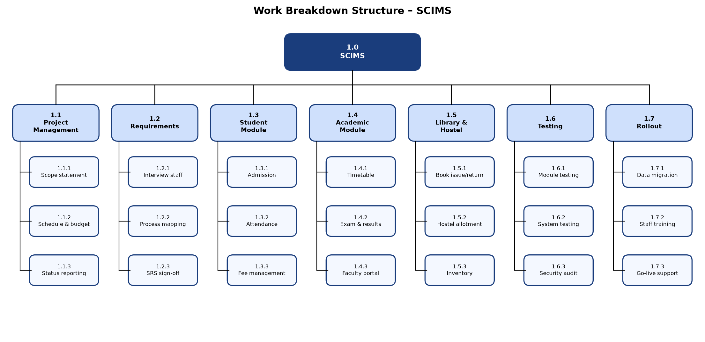
*WBS – SCIMS*

### Conclusion
SCIMS was decomposed into seven Level-2 elements – project management, requirements, three functional module groups, testing and rollout – and twenty-one work packages. The product-oriented WBS shows that every module and supporting activity is covered, and it forms the basis for the schedule and the budget.

---

## Experiment 5: Decision Tree

### Aim
To use a decision tree and Expected Monetary Value (EMV) analysis to select the best alternative in a project decision.

### Theory
A **decision tree** is a diagram used to choose between alternatives whose outcomes are uncertain. It uses three kinds of node:

- **Decision node** (square) – a choice the manager makes.
- **Chance node** (circle) – uncertain outcomes, each with a probability; the probabilities on one node add up to 1.
- **End node** (triangle) – the final payoff of a path.

The tree is solved from right to left (*roll-back*). At each chance node

\\[ \text{EMV} = \sum_i p_i \times v_i , \\]

and the net value of an alternative is \\( \text{EMV} - \text{investment} \\). At the decision node the alternative with the highest net EMV is chosen and the other branches are *pruned* (marked //).

### Situation
**MediTrack Hospital** needs a new patient-records system and has three options (values in lakh rupees):

| Option | Investment | Outcome 1 (*p*, payoff) | Outcome 2 (*p*, payoff) |
|---|:-:|:-:|:-:|
| Build in-house | 60 | High demand (0.6, 200) | Low demand (0.4, 80) |
| Buy (COTS) | 40 | Smooth fit (0.7, 150) | Heavy customisation (0.3, 60) |
| Outsource | 50 | On-time delivery (0.5, 170) | Vendor delays (0.5, 70) |

Draw a decision tree and find the best option.

### Solution
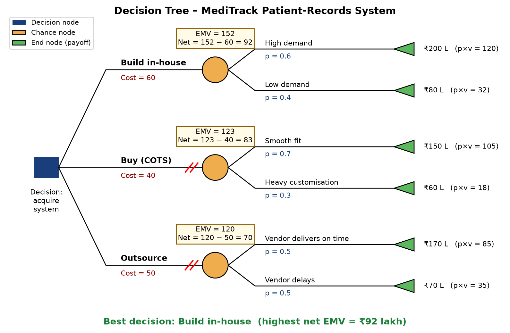
*Decision Tree – MediTrack*

### Conclusion
The net EMVs are 92 (build), 83 (buy) and 70 (outsource) lakh rupees. The hospital should therefore **build the system in-house**. The decision tree turned an uncertain choice into a clear, quantitative comparison.

---

## Experiment 6: Risk Analysis

### Aim
To identify, analyse and prioritise the risks of a software project and plan a response for each.

### Theory
A **risk** is an uncertain event that, if it occurs, affects a project objective. Risk management has four steps: *identification*, *analysis*, *response planning* and *monitoring*.

In **qualitative risk analysis** each risk is rated for *probability* \\(P\\) and *impact* \\(I\\) on a 1–5 scale, and

\\[ \text{Risk exposure (score)} = P \times I . \\]

The risks are plotted on a **probability–impact matrix**, which is divided into low (green), medium (amber) and high (red) zones. High risks get immediate attention. The response strategies are:

- **Avoid** – change the plan to remove the risk.
- **Mitigate** – reduce its probability or impact.
- **Transfer** – shift it to a third party (insurance, contract).
- **Accept** – acknowledge it and keep a contingency reserve.

All of this is recorded in a **risk register**.

### Situation
A university is building **EduLearn**, a cloud e-learning portal with live and recorded lectures, quizzes and online exams. The team identified nine risks: changing faculty requirements, a key developer leaving, a server outage during exams, video streaming latency, budget overrun, a data privacy breach, low student adoption, deprecation of a third-party API and a schedule slip in testing. Analyse these risks using a probability–impact matrix and prepare a risk register.

### Solution
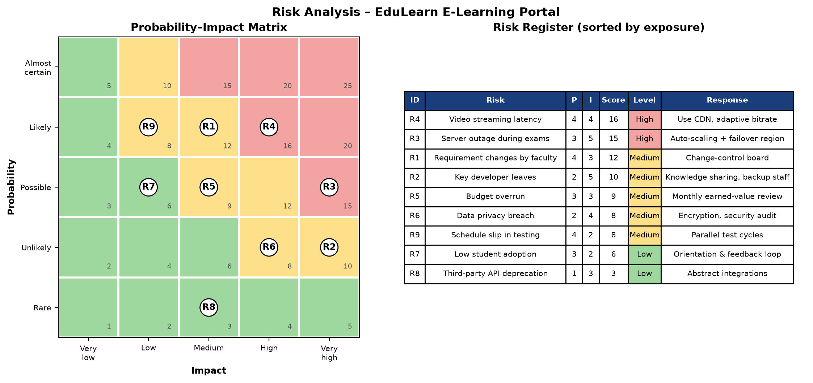
*Risk Analysis – EduLearn*

### Conclusion
Video streaming latency (R4, score 16) and server outage during exams (R3, score 15) are the high-priority risks. They will be mitigated with a CDN and auto-scaling with failover. Five risks are medium and two are low. The matrix and the register show the team where to spend its risk-management effort first.

---

## Experiment 7: Network Diagram and Gantt Chart

### Aim
To draw the activity network diagram of a project and the Gantt chart that corresponds to it.

### Theory
A **project network diagram** shows the logical order (dependencies) of the activities. In the **Activity-on-Node (AON)** or *precedence diagramming method*, each activity is a box and the arrows show dependencies. Most dependencies are *finish-to-start*: an activity can start only after all its predecessors finish.

The longest path through the network is the **critical path**; its length is the minimum project duration. An activity not on the critical path has **float** (slack): it can be delayed by that amount without delaying the project.

The **Gantt chart** is drawn from the network by placing each activity at its earliest start time. Critical activities are highlighted, and the float of non-critical activities is shown as a hatched extension. The network shows *logic*, and the Gantt chart shows *timing*.

### Situation
**ShopKart**, a local electronics retailer, wants an e-commerce website. The activities are:

| Activity | Description | Predecessor(s) | Duration (days) |
|:-:|---|---|:-:|
| A | Requirement study | – | 4 |
| B | UI design | A | 6 |
| C | Database design | A | 5 |
| D | Frontend coding | B | 10 |
| E | Backend & APIs | C | 8 |
| F | Payment API integration | E | 4 |
| G | Testing | D, F | 5 |
| H | Content upload | D | 3 |
| I | Deployment | G, H | 2 |

Draw the AON network diagram and the corresponding Gantt chart.

### Solution
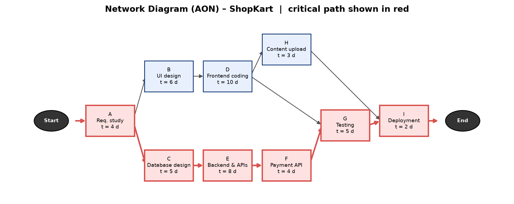
*AON Network Diagram – ShopKart*

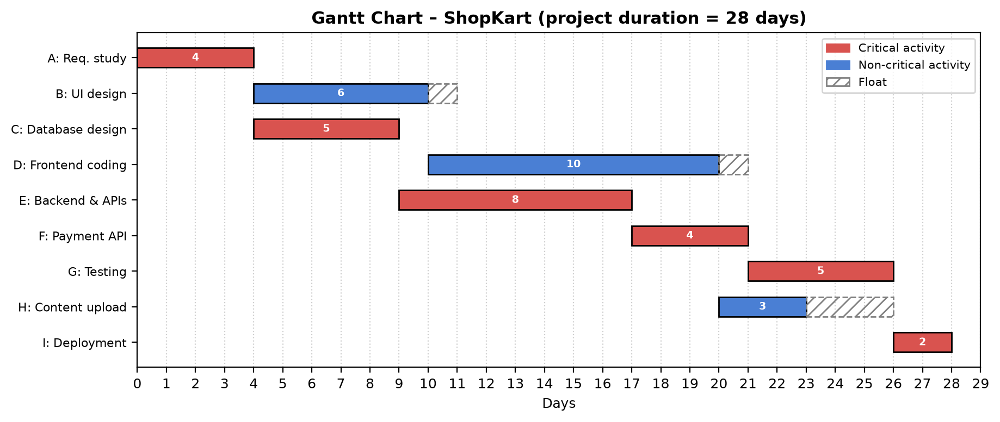
*Gantt Chart – ShopKart*

### Conclusion
The critical path is A–C–E–F–G–I, and the project takes 28 days. Activities B and D have 1 day of float and H has 3 days. The network diagram shows the order of the work, and the Gantt chart shows when each activity takes place.

---

## Experiment 8: Critical Path Method (CPM)

### Aim
To find the critical path, the project duration and the float of each activity using the Critical Path Method.

### Theory
CPM is a deterministic scheduling technique: each activity has one known duration \\(D\\).

- **Forward pass**: \\(ES = \max(EF \text{ of predecessors})\\), \\(EF = ES + D\\) (starting with \\(ES = 0\\)).
- **Backward pass**: \\(LF = \min(LS \text{ of successors})\\), \\(LS = LF - D\\) (starting with \\(LF\\) = project duration).
- **Total float**: \\(TF = LS - ES = LF - EF\\).
- Activities with \\(TF = 0\\) are **critical**; they form the **critical path**, the longest path in the network.

Any delay on a critical activity delays the whole project, so these activities need the closest monitoring. CPM is also used to decide which activities to *crash* when the project must be shortened.

### Situation
A company is rolling out **HRConnect**, an HR and payroll system:

| Activity | Description | Predecessor(s) | Duration (days) |
|:-:|---|---|:-:|
| A | Project kick-off | – | 3 |
| B | Requirement analysis | A | 5 |
| C | Procure servers | A | 7 |
| D | System design | B | 6 |
| E | Employee module | D | 8 |
| F | Payroll module | D | 10 |
| G | Server setup | C | 4 |
| H | Integration | E, F, G | 5 |
| I | User training | E | 3 |
| J | Go-live | H, I | 2 |

Using CPM, find ES, EF, LS, LF and the float of every activity, the critical path and the project duration.

### Solution
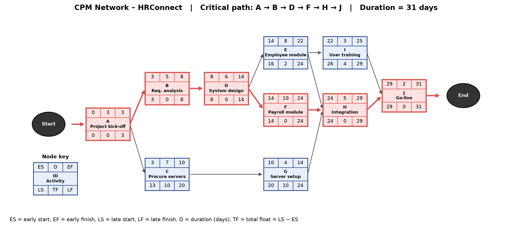
*CPM Network – HRConnect*

### Conclusion
The critical path is **A–B–D–F–H–J**, and the project takes **31 days**. Activities C and G have 10 days of float, E has 2 days and I has 4 days. The manager should watch the critical activities closely and can use the float of C and G to reallocate resources.

---

## Experiment 9: PERT (Program Evaluation and Review Technique)

### Aim
To estimate the expected project duration with PERT and to find the probability of completing the project by a given deadline.

### Theory
PERT is a *probabilistic* technique for activities whose durations are uncertain. Each activity has three estimates: *optimistic* \\(a\\), *most likely* \\(m\\) and *pessimistic* \\(b\\). Assuming a beta distribution:

\\[ t_e = \frac{a + 4m + b}{6}, \qquad \sigma^2 = \left(\frac{b - a}{6}\right)^2 . \\]

The network is then solved with \\(t_e\\) as in CPM to find the critical path. The project duration \\(T_e\\) is the sum of \\(t_e\\) along the critical path, and its variance is the sum of the critical activities' variances. By the central limit theorem the project time is approximately normally distributed, so

\\[ Z = \frac{T_s - T_e}{\sigma_{cp}}, \qquad P(T \le T_s) = \Phi(Z), \\]

where \\(T_s\\) is the scheduled (target) date.

### Situation
A student team is building **CampusRide**, a college shuttle-booking app (times in weeks). The college wants it within **26 weeks**.

| Activity | Description | Predecessor(s) | *a* | *m* | *b* |
|:-:|---|---|:-:|:-:|:-:|
| A | Market survey | – | 2 | 3 | 6 |
| B | Requirement spec | A | 3 | 4 | 8 |
| C | UI prototype | A | 2 | 4 | 6 |
| D | Backend & maps API | B | 6 | 8 | 16 |
| E | Mobile app coding | B, C | 5 | 7 | 12 |
| F | Payment wallet | C | 2 | 3 | 4 |
| G | Testing | D, E, F | 3 | 5 | 7 |
| H | Launch | G | 1 | 2 | 3 |

Find the expected duration, the critical path, and the probability of finishing within 26 weeks.

### Solution
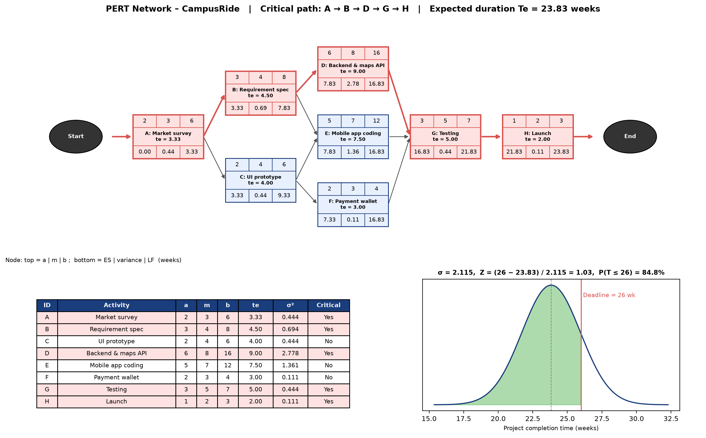
*PERT Analysis – CampusRide*

### Conclusion
The critical path is **A–B–D–G–H**, with an expected duration of \\(T_e = 23.83\\) weeks and \\(\sigma = 2.115\\) weeks. With \\(Z = 1.03\\), the probability of finishing within 26 weeks is about **84.8%**. PERT accounts for uncertainty in the estimates and gives a confidence level for the deadline, which CPM alone cannot do.

---

## Experiment 10: Resource Levelling

### Aim
To level the resource requirement of a project by rescheduling non-critical activities within their float, without increasing the project duration.

### Theory
When all activities start at their earliest start times, the daily resource demand often has sharp peaks and troughs. This is costly, because staff must be hired for peak days and sit idle on other days. A **resource histogram** plots resource units needed against time.

**Resource levelling** (more precisely, *resource smoothing*) shifts *non-critical* activities within their float so that the histogram becomes as flat as possible while the project end date stays the same. Common measures of smoothness are the peak demand, the range (max − min) and the sum of squares \\(\sum R_t^2\\). A smaller \\(\sum R_t^2\\) means a flatter profile. The procedure is:

1. Draw the network, find ES and float, and draw the ES schedule and its histogram.
2. Take the non-critical activities in order of increasing float and try every start time from ES to LS.
3. Keep the start time that minimises \\(\sum R_t^2\\) while respecting all dependencies.

If resources are strictly limited, the end date may have to move instead (*resource-constrained scheduling*).

### Situation
The **FitPulse** fitness-tracker companion app is being built with this plan (R = developers needed per day):

| Activity | Description | Predecessor(s) | Duration (days) | R/day |
|:-:|---|---|:-:|:-:|
| A | Requirements | – | 3 | 2 |
| B | UI design | A | 4 | 3 |
| C | API design | A | 2 | 2 |
| D | Sensor SDK | A | 3 | 4 |
| E | App screens | B | 5 | 3 |
| F | Backend | C | 4 | 4 |
| G | Sync service | D | 2 | 3 |
| H | Testing | E, F, G | 3 | 2 |

The company can hire at most 9 developers. Level the resources without extending the 15-day schedule.

### Solution
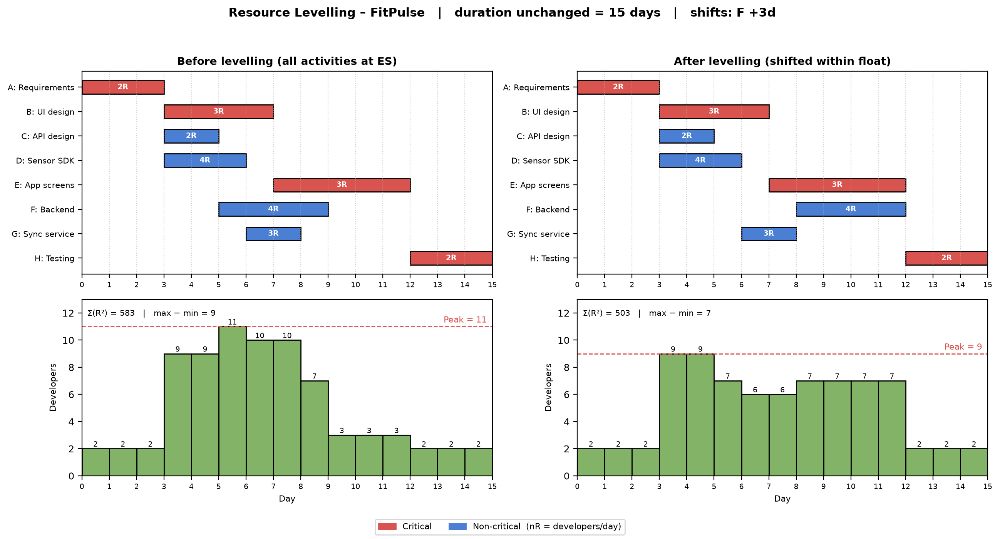
*Resource Levelling – FitPulse*

### Conclusion
With every activity at its earliest start the peak demand was 11 developers and \\(\sum R^2 = 583\\). Moving the non-critical activity F (Backend) 3 days later, within its float, lowered the peak to **9 developers** and \\(\sum R^2\\) to 503. The duration stayed at 15 days, and the 9-developer limit is now met.
